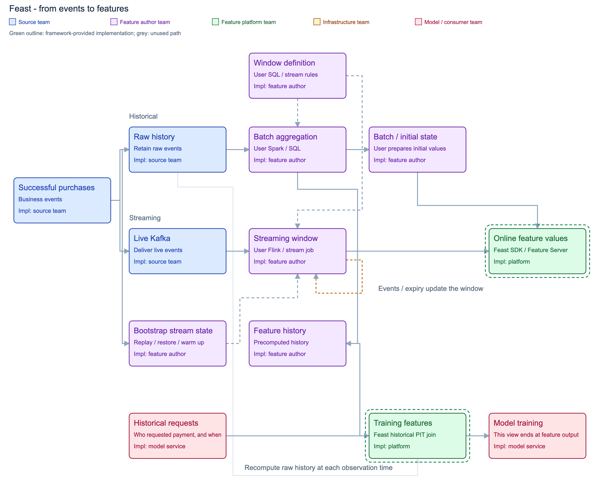
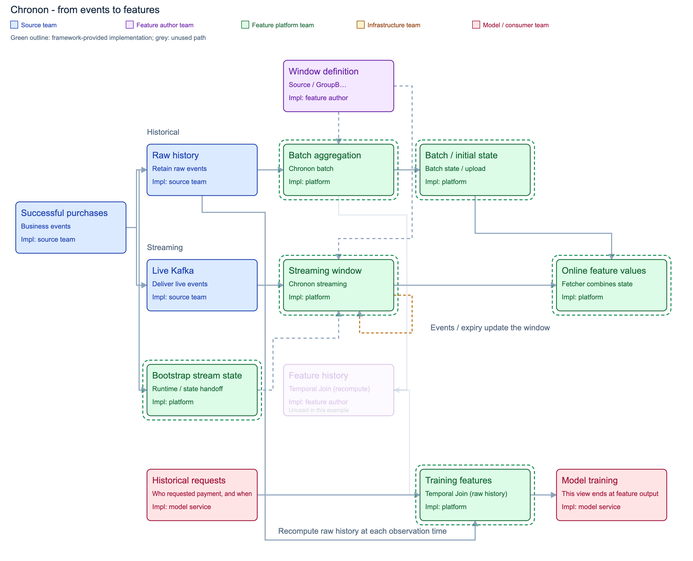
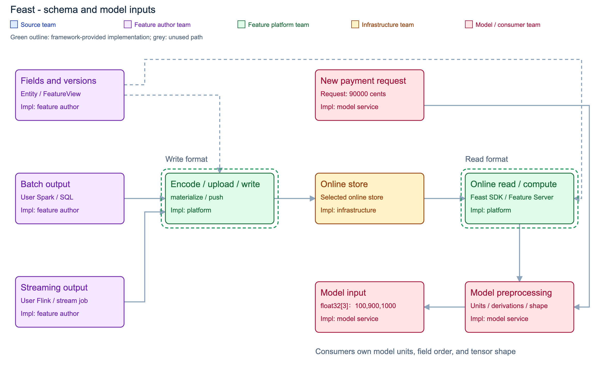
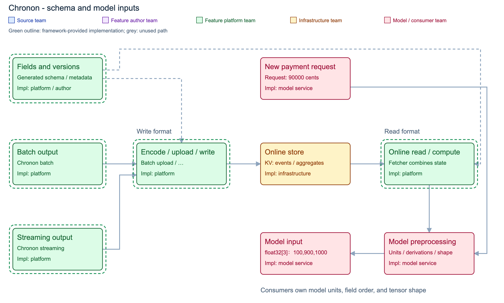
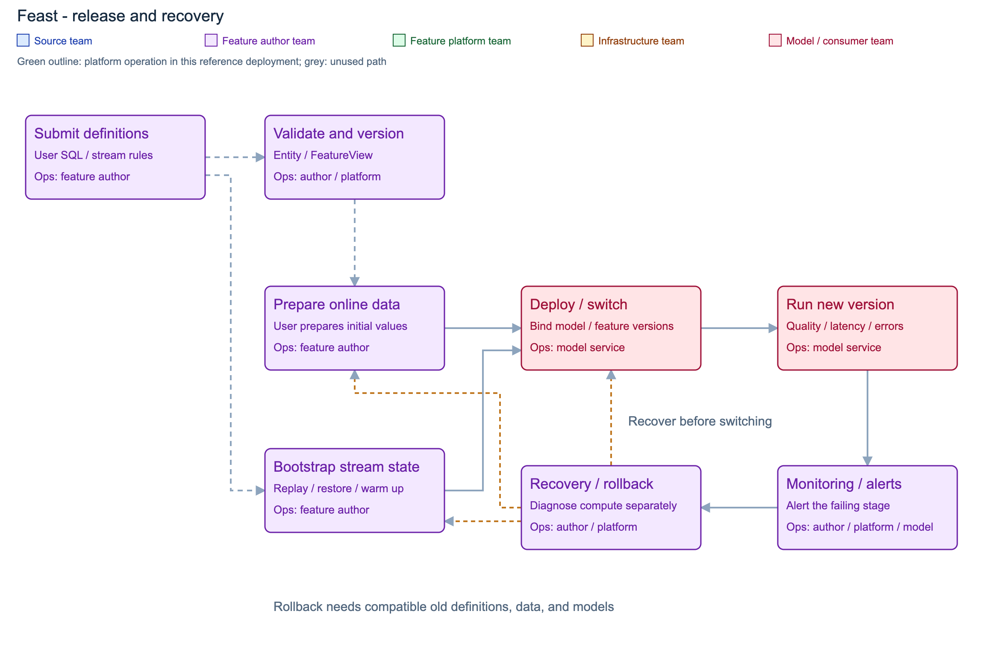
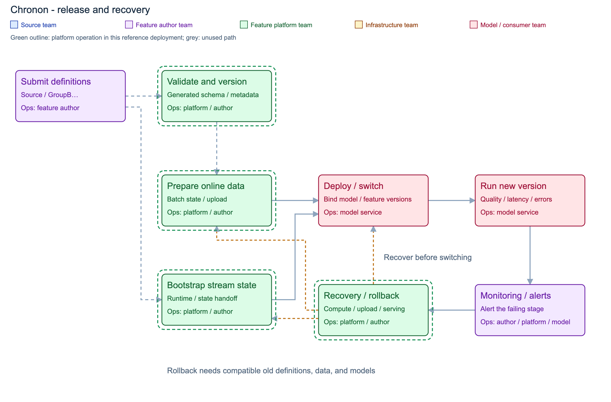

# A 24-hour purchase feature: Feast and Chronon

Research baseline: 2026-10-14; Feast v0.67.0 and Chronon commit
`5bbc4d176a205e32b4172b8f0ecd360072cdb0fe`. This is a synthetic learning example,
not production data, a deployment test, or a performance guarantee.

This guide owns the example, workflow diagrams, schema boundary, operational
checklist, and numerical oracle. For capability history and extension limits,
see the [platform comparison](feast-chronon-comparison.md).

## 1. Define the business contract

`user_purchase_amount_24h_cents_v1` sums successful purchases for a user with
event times in `[T - 24 hours, T)`. Use UTC and integer USD cents. Exclude the
current, not-yet-successful request. This is a continuous window, not yesterday
or the current calendar day.

V1 measures gross successful purchases: refunds do not rewrite past purchase
events. Net spending would require a different definition and update policy.
If the real source records attempts before scoring, explicitly redefine the
event type and how to exclude the current request.

| Dataset | Essential fields | Purpose |
|---|---|---|
| Successful purchases | `purchase_id, user_id, amount_cents, currency, event_time, source_available_at` | Window computation and duplicate detection |
| Historical requests | `request_id, user_id, request_time, amount_cents` | Training observations and historical request context |
| Mature labels | `request_id, fraud_label, label_observed_at` | Training targets, not features known at request time |

The raw Kafka topic and warehouse history represent the same business events.
Validate IDs, amounts, timestamps, filtering, and coverage across them. Defining
a FeatureView or GroupBy does not create reliable event delivery, historical
retention, or those datasets.

For 90 days of training observations, a 24-hour feature normally needs at least
24 additional hours before the earliest observation, plus allowance for late
data and corrections. Kafka retention need not equal warehouse retention.

### Numerical example

At `2026-10-14 12:00:00 UTC`, user `user_42` has:

| Purchase | Event time | Amount | In the window? |
|---|---|---:|---|
| `purchase_old` | Oct 13, 11:59:59 | $500 | No |
| `purchase_a` | Oct 13, 12:01:00 | $40 | Yes |
| `purchase_b` | Oct 14, 09:00:00 | $60 | Yes |

The current request is $900. Historical spending is $100; projected spending is
$1,000 if the request succeeds. Projected spending is a request-time model
input, not an early write into successful-purchase history. A large amount
alone is not evidence of fraud.

After success at `12:00:02`, the processed online total becomes $1,000.
At `12:01:01`, `purchase_a` has expired, so the correct total becomes $960 even
if no new purchase arrives. At exactly `12:01:00`, it is still included because
the left boundary is inclusive. These values define the business oracle, not
a promise that every framework implements this exact window.

## 2. Keep data and ingestion boundaries separate

| Object | Example | What it cannot replace |
|---|---|---|
| Raw event | A $40 purchase with an ID and timestamp | A computed 24-hour total |
| Aggregation state | Events, expiry times, buckets, totals, deduplication state | Just the final scalar |
| Feature value | `user_42, as_of=12:00, spend=10000` | Sufficient state to resume window computation |
| Training row | Request time, request amount, historical spending, label | A latest-value online table |

"Ingestion" can mean raw-event delivery or writing already-computed feature
values. "Materialization" can mean computing and persisting results, or merely
loading existing results into another store. State the input and destination:
common Feast materialization loads existing historical feature values, while
Chronon can produce historical training output or online aggregation state.[F1] [C1]

The diagrams below show reference responsibilities, not any company's
organization chart. Green dashed outlines mean framework-provided implementation
in computation/schema diagrams and platform operation in deployment diagrams.
Grey paths are not used by this example.

## 3. Feast: compute first, then standardize feature access

This example uses externally computed feature history. It does not describe all
v0.67.0 capabilities: BatchFeatureView and StreamFeatureView also provide compute
extensions with alpha warnings and engine/backend limits.[F4]



### Infrastructure and historical computation

Prepare a feature repository and `feature_store.yaml`, a registry, compatible
offline/online stores, credentials, batch/stream runtimes, materialization
scheduling, and SDK or feature-server access with authentication and monitoring.
An existing platform can provide these shared facilities.[F1]

External Spark/SQL computes timestamped `user_purchase_features_v1` from raw
purchases. Feast retrieves historical rows for training and materializes eligible
values online. The offline store can query an existing warehouse; it need not
duplicate all raw history into a separate Feast database.

History must have the required temporal resolution. Daily snapshots do not
answer arbitrary-second sliding-window queries exactly. Options include state
changes at event/expiry times, explicitly approximate periodic snapshots, or
external recomputation at each observation time.

### Register the result contract

This API-shape example assumes the environment supplies the batch data source,
backend configuration, and real table names:

```python
from datetime import timedelta

from feast import Entity, FeatureService, FeatureView, Field, PushSource
from feast.types import Int64

user_entity = Entity(name="user", join_keys=["user_id"])

# purchase_feature_history is a configured batch DataSource
# whose timestamp field is feature_time.
purchase_updates = PushSource(
    name="user_purchase_updates_v1",
    batch_source=purchase_feature_history,
)

purchase_view = FeatureView(
    name="user_purchase_24h_v1",
    entities=[user_entity],
    ttl=timedelta(hours=1),
    schema=[Field(name="spend_24h_cents", dtype=Int64)],
    source=purchase_updates,
    online=True,
)

fraud_features = FeatureService(
    name="fraud_features_v1",
    features=[purchase_view],
)
```

Here `ttl=1 hour` limits the age of eligible historical feature records. It is
not the purchase window, a freshness SLA, or a uniform physical-expiry policy
across online backends. Choose it together with snapshot/heartbeat frequency.[F3]

`feast apply` applies registry definitions and may create or update resources.
It does not prove that computation, streaming, or online data is ready; validate
resource changes in development first.

### Online updates and bootstrap

The external stream job partitions by user, deduplicates purchases, maintains
the 24-hour state, handles late data and expiry, then pushes computed values:

```python
from feast.data_source import PushMode

feature_store.push(
    "user_purchase_updates_v1",
    feature_updates_dataframe,
    to=PushMode.ONLINE_AND_OFFLINE,
)
```

Use bounded batches, not an unbounded pandas collection of the stream.
`ONLINE_AND_OFFLINE` names two destinations; it does not promise an atomic
cross-store transaction or identical connector support. Verify retries,
idempotence, reconciliation, and backend write capabilities.[F2]

At initial deployment:

1. Select a consistent historical snapshot and traceable stream position.
2. Restore compatible window state or replay enough raw history.
3. Prepare initial feature values in the new version/namespace.
4. Process the live tail without omissions or duplicates.
5. Enable consumption only after state and online values are complete.

Materializing $100 into Redis does not restore an external Flink window.
Starting that window empty could produce $900 rather than $1,000 after the next
purchase. Restoring only the scalar $100 is also insufficient: the job must know
when its $40 and $60 contributions expire. Bucketed state needs explicit
boundary/error semantics.

An event-time snapshot boundary is not a Kafka offset. Out-of-order and late
events require an explicit handoff protocol, not simply "read events after T0."
Expiry must produce updated values even for idle users or idle partitions.

### Training and serving

Historical observations include user, request time, and the original request
amount:

```python
training_result = feature_store.get_historical_features(
    entity_df=request_observations,
    features=["user_purchase_24h_v1:spend_24h_cents"],
)
```

Join the resulting features with mature labels. An On-Demand FeatureView can
reuse request-time transformations across historical/online retrieval, or the
model can share preprocessing code.[F5] Training, model deployment, and payment
decisions are outside registry definition.

The producer/platform still owns window correctness, timers/watermarks,
checkpoints, history writes, pushes, materialization, and recovery. Test that
older batch output cannot overwrite newer streaming values; behavior depends
on the connector rather than a universal Feast guarantee.

## 4. Chronon: share computation definitions across execution paths



### 4.1 Infrastructure

Prepare warehouse access, stream decoding, Spark batch execution, a selected
streaming runtime, a semantically compatible KV integration and bulk loader,
Fetcher/service integration, configuration deployment, orchestration, logging,
and consistency checks. Airflow is a well-documented option, not mandatory.
The initial platform integration buys reuse across features; it does not remove
infrastructure operation.[C1] [C3]

### 4.2 Source and GroupBy

This illustrative definition assumes source deduplication and currency checks
have already been agreed:

```python
from ai.chronon.api.ttypes import EventSource, Source
from ai.chronon.group_by import (
    Accuracy,
    Aggregation,
    GroupBy,
    Operation,
    TimeUnit,
    Window,
)
from ai.chronon.query import Query, select

purchase_events = Source(
    events=EventSource(
        table="warehouse.raw_purchases",
        topic="raw.purchases.v1",
        query=Query(
            selects=select("user_id", "purchase_id", "amount_cents"),
            time_column="event_time_ms",
        ),
    )
)

user_purchase_v1 = GroupBy(
    sources=[purchase_events],
    keys=["user_id"],
    aggregations=[
        Aggregation(
            input_column="amount_cents",
            operation=Operation.SUM,
            windows=[Window(length=24, timeUnit=TimeUnit.HOURS)],
        )
    ],
    accuracy=Accuracy.TEMPORAL,
    online=True,
)
```

`event_time_ms` is a mapped millisecond timestamp. The example omits deployment
metadata, partitions, decoders, permissions, and sizing. Source binds raw history
to the topic; GroupBy defines the computation. That is a different input boundary
from the externally computed Feast history used above.[C2] [C4]

### 4.3 Validate the actual window semantics

Do not treat that configuration as a verified implementation of strict
`[T-24h, T)`. Chronon's documented sawtooth windows can retain a wider older
boundary: the one-hour example at 14:27 can cover 13:20-14:27, not
13:27-14:27.[C4]

If the model accepts this explicitly defined approximation, align training and
serving with it. If the business requires a strict sliding window, verify the
selected implementation and extend it or use a different computation path as
needed. Silently changing the business definition is not a valid comparison.
Matching offline and online values does not prove the business definition is right.

### 4.4 Historical training versus online preparation

Chronon Join uses historical request observations on the left and GroupBy
features on the right to compute feature columns from raw history at the
appropriate times. Add mature labels separately. Contextual inputs such as the
original request amount must have been recorded and correctly connected;
derivations cannot recover missing historical context.[C5]

Historical Join output and online batch preparation are separate paths.
Batch preparation builds values or aggregation state for upload to KV.
Streaming adds events, changes, or tiles. Fetcher combines the appropriate
batch/stream state to return features; the online store is not necessarily a
single final scalar per key. Tiled execution moves more aggregation to the write
path; runtime/version behavior must be checked individually.[C6]

### 4.5 Bootstrap, iteration, and operation

1. Compile and validate Source/GroupBy/Join, schemas, and hot-key behavior.
2. Run online batch preparation and the deployment's KV upload.
3. Start or confirm streaming and validate historical coverage/tail handoff.
4. Publish serving metadata and read back through the real Fetcher path.
5. Check boundaries, duplicate/late events, and recovery before enabling traffic.

`online=True` is not evidence that jobs run, data was uploaded, or consumers
caught up. Airflow's example 15-minute streaming keep-alive check is a liveness
schedule, not the stream's event-processing cadence.[C3]

Batch refresh, Join frontfill, streaming, and consistency comparison are distinct
jobs. A stale batch baseline can leave a longer stream tail and raise fetch cost.
Monitor state, checkpoints, source decoding, uploads, KV behavior, Fetcher
CPU/serialization, and tiled versus untiled sizing, not merely job liveness.

Online GroupBy changes have protection rules; use new feature versions rather
than silently changing a model's existing semantics.[C4]

## 5. Schema, model inputs, and historical visibility

### Field contracts are not business semantics

| Boundary | Feast example | Chronon example |
|---|---|---|
| Declaration | Entity/FeatureView fields describe keys and results | Definitions drive schema and serving metadata |
| Write representation | Materialization/push uses the selected connector's encoding | Batch upload and streaming can encode values, events, or aggregation state |
| Read representation | SDK/server retrieves and decodes online features | Fetcher decodes and may combine state before returning typed values |
| Model contract | Consumer defines units, ordering, preprocessing, and tensor shape | Same consumer responsibility |

An `int64` amount does not say whether it is cents or dollars. Validate producer
and consumer versions, units, and encoding separately from window correctness.
For this example, convert historical `10000` cents and current `90000` cents to
`float32[3] = [100.0, 900.0, 1000.0]` dollars, ordered
`[history, current, projected]`. Training and inference must use the same mapping.
Keep missing, timeout, and stale states distinct from zero spending.





### Event-time truth versus inputs actually known

A $30 purchase occurring at 11:58 but first arriving at 12:05 was not available
for the 12:00 decision. The known-input historical amount was $100; retrospective
event-time recomputation yields $130.

Choose explicitly whether training should reconstruct retrospective facts or
the actual decision inputs. `source_available_at` identifies one acquisition
stage, not necessarily availability in the feature store or model. Neither
event-time PIT retrieval nor a shared computation definition reconstructs missing
availability history automatically.[F3] [C7]

Record, subject to access/retention/deletion requirements: request ID/time,
current amount, returned feature values and error/missing flags, feature and
model/preprocessing versions, available computation progress, and decision/label
association keys. These are recommended records, not fields every framework
automatically returns.

## 6. Change data, features, and models independently

New purchases and expirations update feature state without retraining the model.
New warehouse partitions can trigger batch/history work; mature labels drive
training selection and evaluation.

For a new window, use a new name, prepare sufficient history and live state,
and switch a compatible model/feature combination. Account for larger
state/checkpoints and the cost of running both versions.

### Example: 24 hours to 7 days, who changes what

Add `user_purchase_amount_7d_cents_v1` next to the 24-hour feature. Use the
section 1 data: `purchase_old` ($500, Oct 13 11:59:59), `purchase_a` ($40),
`purchase_b` ($60), and no earlier purchases. Two training observations:

| Observation | Request time | Correct 24h | Correct 7d |
|---|---|---:|---:|
| R1 | Oct 13 12:00 | $500 | $500 |
| R2 | Oct 14 12:00 | $100 | $600 |

At Oct 14 12:00 the running 24-hour stream state no longer contains
`purchase_old`; it expired one second earlier. Changing that job's window
parameter from 24h to 7d cannot bring it back, so the online value would start
at $100 instead of $600.

| Task | Feast example path | Chronon path |
|---|---|---|
| Change the aggregation | The producer edits its batch SQL and stream job window (or adds jobs), and raises state retention and expiry timers to 7 days | The author publishes a new GroupBy with `Window(length=7, timeUnit=TimeUnit.DAYS)`; the same aggregation code runs |
| 7-day values for 90 days of training observations | The producer recomputes timestamped history from raw purchases, for example a range join with `purchase_time >= request_time - INTERVAL 7 DAYS`, writes it to the offline source, then calls `get_historical_features` | A Join that references the new GroupBy is backfilled over the observations; Chronon recomputes R1 = $500 and R2 = $600 from raw history |
| Make the online value 7-day | The new stream job is seeded with the last 7 days of events and their timestamps, outputs $600, then pushes; it must also emit $100 when `purchase_old` leaves the window at Oct 20 11:59:59 with no new purchase | Run the batch upload for the new GroupBy, start its streaming job, publish metadata; Fetcher merges batch state with streaming data at read time |
| Source history needed | Raw purchases for 90 days plus 7 days, in the producer's job | The same retention, readable by Chronon's Spark jobs |

In both paths the existing 24-hour online state cannot be reused as 7-day state.
The difference is who writes the window logic: in the Feast example the producer
ships programs that compute $500, $600, and the later $100; in Chronon the author
ships the source binding and the `SUM` over 7 days, then runs framework jobs.

Window semantics change with length. In `FiveMinuteResolution`, the default of
the online sawtooth aggregator, windows from 12 hours up to 12 days use a
one-hour tail hop, and windows of 12 days or more use a one-day hop
([Resolution.scala](https://github.com/airbnb/chronon/blob/5bbc4d176a205e32b4172b8f0ecd360072cdb0fe/aggregator/src/main/scala/ai/chronon/aggregator/windowing/Resolution.scala#L37-L46)).
A 7-day sawtooth window can therefore include events up to one hour older than
the exact 7-day boundary; apply the section 4.3 check again.

A preprocessing-only change may reuse the base spending aggregate: update the
ODFV/shared model preprocessing or appropriate Join derivation, and recompute or
validate affected training outputs.[C8] Whether base features need a backfill
depends on which semantics changed.

Retain old definitions, data/state, and models until rollback is no longer
needed. Gate rollout on data readiness, restored stream state, consumer
compatibility, and small-traffic feature/service/model observations.
Before activation, check producer/consumer versions, permissions, quotas, and
required resources; initialize and catch up new state before switching traffic.

## 7. Operate and diagnose the complete pipeline

Raw-event quality belongs to source owners; the example's external Feast
computation belongs to its producer; shared Chronon execution and KV/orchestration
need platform ownership. Model inputs, thresholds, and fallbacks remain model
and business responsibilities. Agree on escalation and handoff boundaries.





| Symptom | Check first |
|---|---|
| HTTP 200 but no new purchase reflected | Source lag, compute progress, sink success, readback, service cache; request success is not freshness |
| $900 instead of $1,000 after the new purchase | Missing stream bootstrap; repeatedly backfilling the store does not repair empty state |
| Idle user remains at $1,000 | Expiry output, timers, watermark, idle keys/partitions; state TTL cleanup is not a correct feature update |
| Retry doubles the amount | Stable IDs, source/sink idempotence, checkpoint boundary; conflicting payloads for one ID require correction |
| Values shrink after deployment/scaling | Lost state, key/serializer changes, failed restore; do not consume incomplete state |
| Batch refresh moves online values backward | Writer versions, timestamps, overwrite rules, and batch/stream handoff |
| Training/serving amounts differ | Late data, availability, window boundaries, currency, filters, and the intended comparison target |
| Chronon fetch latency grows over time | Baseline age, stream-tail length, hot keys, tiled path; scaling readers alone may hide the failed refresh |
| Online is healthy but training history stops | Independent history/tracking/frontfill progress; online sink success does not prove historical completeness |

Monitor per-partition lag and invalid/duplicate events; watermarks, state and
checkpoint cost; write attempts/failures/retries/quarantine; readback and
materialization versions; p95/p99 latency, errors and missingness; synthetic
end-to-end and idle-expiry checks; training coverage, label maturity, drift and
model/preprocessing versions. Alert the owner of the failing stage.

An inactive user's old event time alone does not prove pipeline staleness.
Combine progress, recomputation/confirmation time, and synthetic events.
Recover or roll back only after checking data and state; do not collapse
unknown, stale, failed, and zero values into the same response.

### Capacity and consistency limits

At 100 million events/day and an assumed 64-byte state payload per event, logical
payload is 6.4 GB. This is not a cluster-memory estimate: keys, serialization,
indexes, deduplication, timers, state backend, checkpoints, replication, and skew
add overhead.

A naive 24-hour window sliding every minute can place one event in 1,440
overlapping windows. Evaluate runtime optimizations, shared state, buckets and
approximate boundaries against the required accuracy.

Two concurrent requests can both read $100; projected spending does not make
one request observe the other's pending purchase. An absolute limit including
concurrent pending payments needs its own ordered/atomic budget or risk-state
boundary. An asynchronous feature pipeline is a signal, not that ledger.

## 8. Acceptance gates and numerical oracle

Before production, demonstrate raw topic/history agreement, correct sample
computation, historical training coverage and mature labels, complete bootstrap,
expiry without new events, replay/restart safety, compatible model inputs and
failure policies, and owned alerts/readback/rollback. Created topics, compiled
definitions, registry merges, or a running job cannot substitute for these checks.

The following data preserves the exact business oracle. It is not a framework
integration test or an assertion about an actual serving value:

```json
{
  "window_hours": 24,
  "currency": "USD",
  "events": [
    {"purchase_id": "purchase_old", "event_time": "2026-10-13T11:59:59Z", "source_available_at": "2026-10-13T12:00:00Z", "amount_cents": 50000},
    {"purchase_id": "purchase_a", "event_time": "2026-10-13T12:01:00Z", "source_available_at": "2026-10-13T12:01:01Z", "amount_cents": 4000},
    {"purchase_id": "purchase_b", "event_time": "2026-10-14T09:00:00Z", "source_available_at": "2026-10-14T09:00:01Z", "amount_cents": 6000},
    {"purchase_id": "purchase_current", "event_time": "2026-10-14T12:00:02Z", "source_available_at": "2026-10-14T12:00:02Z", "amount_cents": 90000},
    {"purchase_id": "purchase_late", "event_time": "2026-10-14T11:58:00Z", "source_available_at": "2026-10-14T12:05:00Z", "amount_cents": 3000}
  ],
  "checks": [
    {"name": "decision_known_input", "as_of": "2026-10-14T12:00:00Z", "known_only": true, "expected_cents": 10000},
    {"name": "after_success", "as_of": "2026-10-14T12:00:03Z", "known_only": true, "expected_cents": 100000},
    {"name": "inclusive_left_boundary", "as_of": "2026-10-14T12:01:00Z", "known_only": true, "expected_cents": 100000},
    {"name": "expiry_without_purchase", "as_of": "2026-10-14T12:01:01Z", "known_only": true, "expected_cents": 96000},
    {"name": "late_event_arrives", "as_of": "2026-10-14T12:05:01Z", "known_only": true, "expected_cents": 99000},
    {"name": "retrospective_event_time", "as_of": "2026-10-14T12:00:00Z", "known_only": false, "expected_cents": 13000},
    {"name": "all_expired", "as_of": "2026-10-15T12:00:03Z", "known_only": true, "expected_cents": 0}
  ]
}
```

`known_only` uses acquisition time to distinguish known inputs from retrospective
truth; real computation and propagation add further delay. Also verify duplicate
IDs, conflicting payloads, empty history versus unavailable data, and incomplete
warm-up.

## Sources

Feast sources are pinned to v0.67.0; Chronon sources use the commit above.
SDK snippets illustrate API shape; they did not create resources, ingest data,
or deploy a model.

[F1]: https://github.com/feast-dev/feast/blob/v0.67.0/docs/getting-started/concepts/data-ingestion.md
[F2]: https://github.com/feast-dev/feast/blob/v0.67.0/docs/reference/data-sources/push.md
[F3]: https://github.com/feast-dev/feast/blob/v0.67.0/docs/getting-started/concepts/point-in-time-joins.md
[F4]: https://github.com/feast-dev/feast/blob/v0.67.0/sdk/python/feast/batch_feature_view.py#L81-L112
[F5]: https://github.com/feast-dev/feast/blob/v0.67.0/docs/reference/beta-on-demand-feature-view.md
[C1]: https://github.com/airbnb/chronon/blob/5bbc4d176a205e32b4172b8f0ecd360072cdb0fe/docs/source/setup/Components.md
[C2]: https://github.com/airbnb/chronon/blob/5bbc4d176a205e32b4172b8f0ecd360072cdb0fe/docs/source/authoring_features/Source.md
[C3]: https://github.com/airbnb/chronon/blob/5bbc4d176a205e32b4172b8f0ecd360072cdb0fe/docs/source/setup/Orchestration.md
[C4]: https://github.com/airbnb/chronon/blob/5bbc4d176a205e32b4172b8f0ecd360072cdb0fe/docs/source/authoring_features/GroupBy.md
[C5]: https://github.com/airbnb/chronon/blob/5bbc4d176a205e32b4172b8f0ecd360072cdb0fe/api/py/ai/chronon/join.py
[C6]: https://github.com/airbnb/chronon/blob/5bbc4d176a205e32b4172b8f0ecd360072cdb0fe/docs/source/Tiled_Architecture.md
[C7]: https://github.com/airbnb/chronon/blob/5bbc4d176a205e32b4172b8f0ecd360072cdb0fe/docs/source/test_deploy_serve/Online_Offline_Consistency.md
[C8]: https://github.com/airbnb/chronon/blob/5bbc4d176a205e32b4172b8f0ecd360072cdb0fe/docs/source/authoring_features/DerivedFeatures.md
