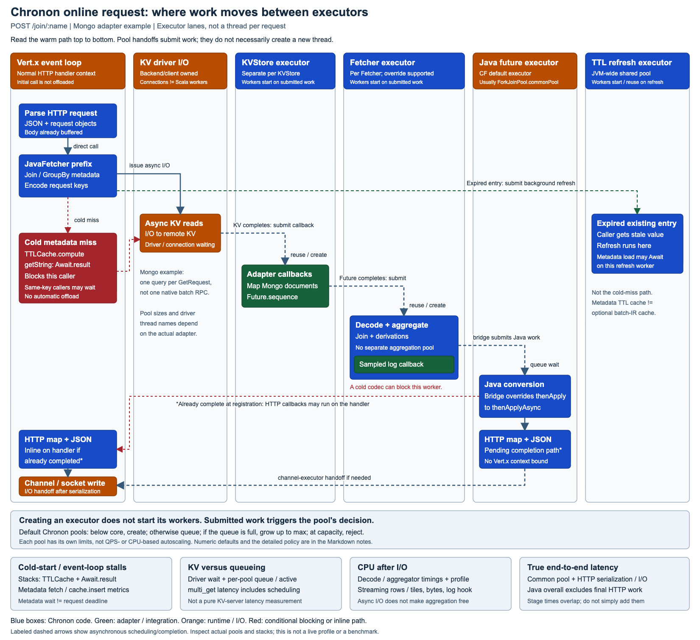

# Concurrency and thread creation



[Full-size diagram](assets/thread-model.png).

This is a source-level execution model, not a measurement of a running deployment.
It follows the standalone HTTP service's `POST /join/:name` route and the Mongo
quickstart adapter in checkout
`5bbc4d176a205e32b4172b8f0ecd360072cdb0fe`. The dependency versions used for this analysis are Scala 2.12.12
and `scala-java8-compat` 0.9.0. Other adapters, Scala versions, embedded callers,
and custom execution contexts can change the thread transitions.

The accepted system architecture diagram is unchanged. This diagram focuses on
the latency-sensitive online request; Airflow, Spark batch jobs, and Flink task
threads are separate processes and are not on this request path. The main diagram
uses executor lanes and marks where runnable work is submitted. The detailed
worker-creation policy stays in these notes rather than a separate decision tree.
The detailed
request-path discussion below includes Join-specific derivation and logging;
the GroupBy endpoint does not perform all of these stages. Optional external features and model
transforms are discussed below rather than added to the main diagram.

## Where does multithreaded execution actually start?

An incoming request already runs on a runtime thread. In the normal standalone
service, this is a Vert.x event-loop context. Direct calls into JavaFetcher and
the initial Fetcher preparation do not themselves offload work.

There is no single point where the entire framework "turns multithreaded":

| Trigger | What actually happens |
|---|---|
| Construct the default Fetcher/KVStore executor, or initialize the shared TTLCache executor | Allocate a `ThreadPoolExecutor` and its queue. Chronon does not call a prestart method; no worker starts merely because this pool object exists. |
| Dispatch KV reads | The adapter/driver can have multiple operations in flight. Mongo's example issues a query per GetRequest. Driver connection/I/O concurrency is separate from Chronon worker count. |
| A Scala Future result becomes available | Its registered transformations become runnable on the associated execution context. Default KVStore and Fetcher contexts submit work to their separate thread pools. |
| Read an expired existing metadata entry | Return the cached value and explicitly submit a refresh with `TTLCache.executor.execute`. |
| First runnable submitted to an unused default Chronon pool | The JDK creates a worker because worker count is below the configured core limit. Other independent pools can still have no workers. |
| More runnable work arrives | The pool creates a worker, queues for existing workers, expands above core, or rejects according to its own policy. |

Registering `map`/`flatMap` on a pending Future is not a worker spawn. If the Future
is already complete, the continuation can become runnable immediately. Creating
`Future { body }` submits the body to an execution context, but still does not
promise a new thread: the executor makes that decision. `Future.sequence`
combines completions; it is not an instruction to create a thread per element.

### The actual decision rule

For each default Chronon pool, assuming it is running and thread creation succeeds:

```text
runnable submitted
    |
    +-- total worker count below core? ---- yes --> create worker with this task
    |
    +-- queue accepts task? --------------- yes --> enqueue; workers consume it
    |
    +-- total worker count below maximum? - yes --> create extra worker
    |
    +--------------------------------------------> reject
```

"Worker count" includes idle workers; it is not the number of busy workers.
Below core, submission may create another worker even when an existing worker is
idle. After reaching core, a busy pool normally queues before expanding above
core. Maximum size alone does not tell you how many threads will run.

The JDK performs shutdown/state rechecks and handles failed worker creation; the
diagram intentionally shows the normal running-pool path, not every race and
failure branch. Its default rejection handler throws `RejectedExecutionException`;
how that manifests in a request depends on the submitting code/Future machinery.
This is not request-level admission control.

QPS, key count, request count, and CPU utilization are not directly sampled by
this factory to decide worker growth. They affect the amount and duration of work,
which can increase queue pressure. Above-core idle workers can retire after
keep-alive; core-thread timeout is not enabled by this factory.

### Who sets the thresholds?

`FlexibleExecutionContext` supplies explicit constructor defaults, shown below.
It is not an autoscaler. It does not read a QPS target or derive these values from
CPU count. Callers can use the factory parameters or an explicit custom executor.
The JavaFetcher builder exposes `executionContextOverride`, but the default
service construction does not set it.

Vert.x event-loop sizing, the KV driver's connection/I/O policies, and the Java
future bridge's common-pool behavior are different policies. Changing the Vert.x
worker-pool setting or a common-pool JVM property does not resize these Chronon
`ThreadPoolExecutor` instances or move the synchronous handler prefix off its thread.

## Executor domains

| Domain | What belongs here | Configuration and scope |
|---|---|---|
| Request caller | HTTP parsing, Java/Scala request conversion and initial Fetcher preparation run synchronously on the calling thread. Returning a Future does not offload this prefix. | Normal standalone deployment: Vert.x event-loop context. Embedded use: application-selected thread. |
| KV driver | Asynchronous network I/O and driver completion mechanisms. | Backend/client dependent. A Future-returning API alone does not guarantee nonblocking implementation. |
| KVStore execution context | KV adapter Future transformations and base KVStore helpers. | `KVStore` creates its own execution context by default. |
| Fetcher execution context | Fetcher Future continuations: response decoding, aggregation, Join assembly, derivations, and sampled logging hooks. | Inherited from `MetadataStore`; new default executor per instance unless overridden. |
| Java CompletableFuture default executor | The Scala 2.12 bridge's first Java response conversion. | Normally the JDK common ForkJoinPool. This is not the Fetcher executor. |
| TTLCache refresh executor | Refresh of existing expired metadata/cache entries. | One shared executor in the `TTLCache` companion object. |

These are executor domains, not one dedicated thread per request. Continuations
within one domain can run on different workers. Separate pools can share the same
generic JDK thread-name pattern; identify them by stack frames and executor identity.

### HTTP entry and response are not symmetric

`FeaturesRouter` uses ordinary `.handler(...)` routes, not `blockingHandler` or
`executeBlocking`. One JavaFetcher is constructed for the feature router and
shared by its Join and GroupBy handlers. The normal verticle deployment uses an
event-loop context. Increasing the Vert.x worker-pool size does not offload these
handlers, and a larger global event-loop pool does not imply parallel processing
of one ordinary verticle's handlers.

The default BodyHandler buffers the body. `FeaturesHandler` then parses JSON,
constructs the request list, and directly calls JavaFetcher. A cold metadata
load can block this event loop before the fetch method returns its Future.

On the response path, `Future.fromCompletionStage(resultsJavaFuture)` is called
without a Vert.x context. With the cached Vert.x 4.5.10 implementation, response
list mapping and JSON encoding can run on the Java future's completing thread,
or inline on the registering handler thread if completion has already occurred.
Races can split stages between these domains. There is no fixed return-to-event-loop
handoff before serialization and no dedicated serialization pool.

The cached HTTP/1 implementation separately schedules off-event-loop channel writes
onto the channel executor. The service ignores the Future returned by
`response.end(...)`: feature success and invocation of `end` do not confirm
successful wire delivery.

### Mongo example: fan-out, not one native batch query

`MongoKvStore.multiGet` creates one `find(...).limit(1).toFuture()` per GetRequest
and combines them using `Future.sequence`. Its Scala mapping/sequence callbacks
use the inherited KVStore execution context, distinct from driver I/O threads.
No adapter semaphore or concurrency limiter is implemented.

One lazy Mongo client is shared per `ChrononMongoOnlineImpl` API instance.
`genKvStore` creates new wrappers around that client; it does not create a client
per HTTP request. Feature logging uses this same client and starts an asynchronous
insert whose completion is not awaited or observed by the logging method.
Logging dispatch is on the response path; successful Mongo log persistence is not.

Do not infer numeric driver-pool limits or driver thread names from Chronon.
The standalone Mongo SBT build declares driver 4.8.1, while the repository's Bazel
dependencies declare 4.11.1. Driver connection waiting, executor queueing, HTTP
requests, keys, and Mongo operations are different quantities.

### Default Chronon executor policy

`FlexibleExecutionContext` constructs a `ThreadPoolExecutor` with:

| Setting | Default |
|---|---|
| Core pool size | 20, created on demand |
| Work queue | `ArrayBlockingQueue`, capacity 1,000 |
| Maximum pool size | 1,000 |
| Non-core idle keep-alive | 600 seconds |
| Thread factory / rejection policy | JDK defaults |

Submissions below 20 total workers can start workers, then the pool queues work.
It grows beyond core when the queue cannot accept more work, up to the maximum;
exhausted capacity rejects tasks. A maximum of 1,000 is neither a startup thread count nor
a request-concurrency limit. This policy applies independently to the default
Fetcher, KVStore, and TTL refresh executors, not to a single shared global pool.

## Metadata cache: two very different paths

`TTLCache` does not treat a cold miss like an expired entry:

| Case | Execution |
|---|---|
| Present and fresh | Return the cached value on the current thread. |
| First access / missing entry | Run the loader synchronously inside `ConcurrentHashMap.compute`. Concurrent callers for that key wait for initialization. |
| Existing entry has expired | Return the old value and enqueue one refresh on `TTLCache.executor`. |

For metadata, the loader calls `KVStore.getString`, whose implementation uses
`Await.result`. A cold miss can therefore block the caller even though the public
fetch method returns a Future. This also applies to lazy codec construction in a
Fetcher continuation: the blocked thread is whichever thread invokes the cache,
not always the HTTP thread.

The default Fetcher/Api metadata timeout is 10 seconds per metadata wait, unless
configured otherwise. It is not an overall request deadline or a cancellation
policy for all feature-value reads. Cache defaults are a two-hour normal TTL and
an eight-second refresh interval for explicit `refresh` calls; `refresh` is not
an unconditional synchronous reload.

The HTTP server's 60-second idle timeout is also not a feature-request deadline.
Neither this service nor its handler installs request-specific cancellation
propagation to all downstream operations.

## Fan-out and response computation

`FetcherBase.fetchGroupBys` creates batch reads and, for temporal features,
streaming reads. It calls `kvStore.multiGet`, then registers a Future continuation.
The adapter determines whether that operation is a native batched RPC, many
concurrent requests, or another implementation.

The response continuation loops over GroupBy requests and performs decoding and
aggregation. There is no separate aggregation thread pool in this code. One
GroupBy is not automatically one worker. Optional batch-IR caching can eliminate
some batch reads and decoding, but is distinct from metadata TTL caching.

`joinFetchParallelChunkSize` divides the input request sequence into chunks and
combines the resulting futures. It does not allocate that many threads, enforce a
global in-flight request limit, or create a pool per chunk. The Java builder's
default is no chunk override; several legacy JavaFetcher constructors specify 32.
Do not infer a deployment's effective value from those constructors alone.

External features and model transforms add adapter-specific asynchronous calls.
The Fetcher joins their results before completing the applicable request.
Sampled response logging invokes `logFunc.accept` on a Fetcher continuation;
offloading or blocking after that call depends on the supplied logging integration.

## The Java future bridge is a real thread transition

`JavaFetcher.convertResponsesWithTs` calls
`FutureConverters.toJava(...).toCompletableFuture().thenApply(...)`.
Despite the method spelling, the resolved Scala 2.12 bridge overrides `thenApply`
to call `thenApplyAsync`. Its first Java response conversion therefore uses the
CompletableFuture default executor, normally the common ForkJoinPool.

The dependent CompletableFuture returned by that conversion has ordinary
non-async continuation semantics: a callback can run on its completing thread,
or on the registering thread if the future has already completed. An HTTP callback
must not be assigned to one fixed pool merely because it follows this conversion.
The JDK can use a fallback executor when common-pool parallelism is insufficient.

A small isolated probe using the already-cached dependency jars and JDK 17 produced:

```text
caller=main
scalaCompletion=probe-scala-completer
javaConversion=ForkJoinPool.commonPool-worker-1
pendingCallback=ForkJoinPool.commonPool-worker-1
alreadyCompletedCallback=main
```

This validates the bridge behavior for the resolved local dependency combination;
it is not a load test or a thread trace of the complete feature service.

## Performance and visibility checkpoints

| Symptom | What to inspect | Interpretation |
|---|---|---|
| First requests stall | Stacks containing `TTLCache`, `ConcurrentHashMap.compute`, `KVStore.getString`, and `Await.result`; metadata cache insert and fetch latency metrics | Cold metadata can block before feature-value I/O starts. Other requests for the same key can wait on initialization. |
| High reported multi-get latency | KV client/backend timings together with KVStore and Fetcher executor queue delay | `multi_get.latency.millis` is recorded inside the Fetcher continuation. It includes time until that continuation runs, not just server/network time. |
| High CPU after KV responds | Decode and aggregation stack frames, streaming rows/tiles and response bytes | GroupBy decoding and aggregation run on Fetcher workers and compete with other continuations. |
| Java response conversion lags | Common-pool activity, queued tasks, and `java.response_conversion.latency.millis` | The bridge adds a separate executor; tuning only the Fetcher pool will not isolate this stage. |
| Latency rises under load without slow KV queries | Active workers, pool size, queue occupancy, rejections, allocation/GC, request batch sizes | Waiting in a continuation queue can dominate latency. Pool saturation is not equivalent to backend latency. |
| Logging or optional integrations extend the request | Sampled logging callback, external source, and model-backend timings | Returning futures does not by itself offload synchronous work inside integration methods. |

Existing metric suffixes include:

- `multi_get.latency.millis`, `multi_get.bytes`, `multi_get.batch.size`
- `group_by.batchir_decode.latency.millis`
- `group_by.all_streamingir_decode.latency.millis`
- `group_by.aggregator.latency.millis`
- `internal.latency.millis`, `derivation_codec.latency.millis`, `derivation.latency.millis`
- `java.request_conversion.latency.millis`, `java.response_conversion.latency.millis`, `java.overall.latency.millis`
- `cache.insert`, `cache.update`, and metadata fetch latency/exception metrics

These are suffixes, not complete dashboard metric names. `Metrics.Context` adds
environment and suffix prefixes and Join/GroupBy tags; the StatsD client prefix is
`ai.zipline`. The default sink is localhost:8125, configurable through JVM
properties. Emission in code does not prove that a running deployment collects it.

Executor queue-wait histograms and HTTP end-to-end spans should be added at the
deployment instrumentation boundary if absent; do not assume this checkout exports
them. Capture thread dumps or JFR/CPU profiles from the actual serving JVM and
correlate them with per-pool queue/active-thread measurements.

The service launcher enables Vert.x and JVM Micrometer metrics through StatsD.
The checked-in README gives examples such as `vertx.http.server.active.requests`
and `jvm.threads.states`; they are examples, not observations from a running server.
Look for stacks in `FeaturesHandler.parseJavaRequest` / Jackson on the event loop,
`FeaturesHandler` response callbacks / `JsonObject.encode` on completion threads,
and `MongoKvStore` transformations on KVStore workers.

For startup-only stalls, inspect `ConfigStore`'s one-second `CountDownLatch.await`
inside verticle startup; do not confuse this with a request's metadata wait.
Avoid collecting `/config` payloads into debugging artifacts: that endpoint can
include credentials. Do not change pool sizes from this static diagram alone;
measure the actual pool and dependency bottleneck first.

### Two measurement traps

`Fetcher.instrumentAndLog` captures `requestEndTs` before its input future has
completed. Its `overall.latency.millis` must not be treated as authoritative
end-to-end completion latency in this checkout. `java.overall.latency.millis`
extends through Java conversion, but still excludes later HTTP serialization and
socket delivery; use an HTTP-level timer for actual request E2E.

Several stage metrics overlap. For example, a multi-get measurement includes
continuation scheduling, and an internal Join measurement wraps more than just KV
reads. Do not sum all reported stage latencies as if they partition the request.

## Source anchors

Paths are relative to the Chronon repository root at the commit above.

| Claim | Source |
|---|---|
| Normal routes and shared Fetcher | `service/src/main/java/ai/chronon/service/handlers/FeaturesRouter.java:14-20` |
| Request parsing, direct call, context-free HTTP continuation | `service/src/main/java/ai/chronon/service/handlers/FeaturesHandler.java:69-132` |
| HTTP startup, idle timeout and shutdown | `service/src/main/java/ai/chronon/service/WebServiceVerticle.java:24-82` |
| Service JVM/Vert.x instrumentation | `service/src/main/java/ai/chronon/service/ChrononServiceLauncher.java:27-55` |
| Mongo fan-out and KVStore callbacks | `quickstart/mongo-online-impl/src/main/scala/ai/chronon/quickstart/online/MongoKvStore.scala:17-38` |
| Shared Mongo client and logging insert | `quickstart/mongo-online-impl/src/main/scala/ai/chronon/quickstart/online/ChrononMongoOnlineImpl.scala:15-38` |
| Executor defaults | `online/src/main/scala/ai/chronon/online/FlexibleExecutionContext.scala:27-46` |
| Worker / queue / maximum decision order | Installed JDK source `java.base/java/util/concurrent/ThreadPoolExecutor.java:1328-1365`, `execute(Runnable)` |
| Fetcher executor ownership | `online/src/main/scala/ai/chronon/online/MetadataStore.scala:41-60` |
| KV executor and blocking metadata helper | `online/src/main/scala/ai/chronon/online/Api.scala:45-103` |
| Cold miss versus stale refresh | `online/src/main/scala/ai/chronon/online/TTLCache.scala:25-96` |
| Join and GroupBy metadata caches | `online/src/main/scala/ai/chronon/online/MetadataStore.scala:123-146,217-242` |
| Synchronous Java entry and conversion callback | `online/src/main/java/ai/chronon/online/JavaFetcher.java:145-152,206-226` |
| Fan-out and Fetcher continuation | `online/src/main/scala/ai/chronon/online/FetcherBase.scala:353-555` |
| Decode and aggregation | `online/src/main/scala/ai/chronon/online/FetcherBase.scala:128-243` |
| Chunking and derived features | `online/src/main/scala/ai/chronon/online/Fetcher.scala:244-265,334-412` |
| Logging and timing caveat | `online/src/main/scala/ai/chronon/online/Fetcher.scala:421-444,484-565` |
| Metrics transport and naming | `online/src/main/scala/ai/chronon/online/Metrics.scala:139-168,195-240` |
| Dependency assumptions | Scala 2.12.12 and scala-java8-compat 0.9.0; confirm the resolved versions in your build |
| Bridge async override | `scala-java8-compat_2.12-0.9.0-sources.jar`, `scala/concurrent/java8/FutureConvertersImpl.scala`, class `CF` |
| Context-free Vert.x callbacks | Vert.x 4.5.10 sources: `io/vertx/core/Future.java:619-650`, `impl/future/FutureBase.java:40-82`, `FutureImpl.java:203-231` |
| HTTP/1 socket-write handoff | Vert.x 4.5.10 sources: `http/impl/Http1xServerResponse.java:389-438`, `net/impl/ConnectionBase.java:221-238` |
